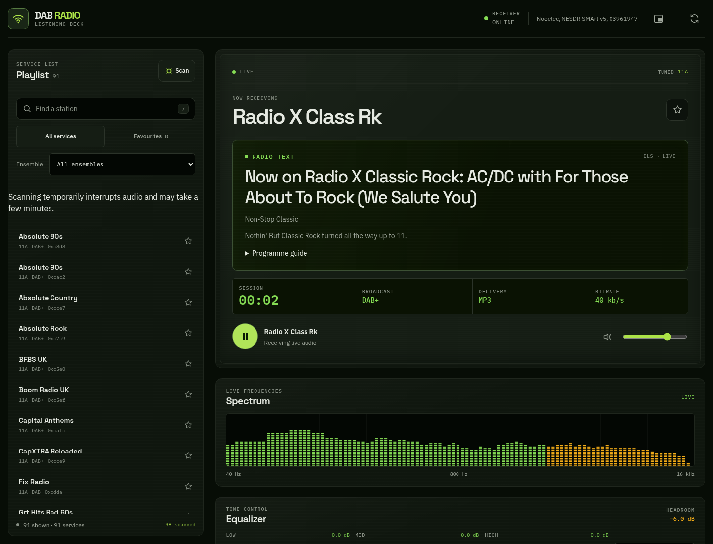
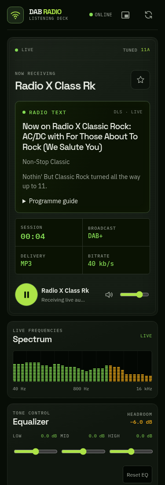
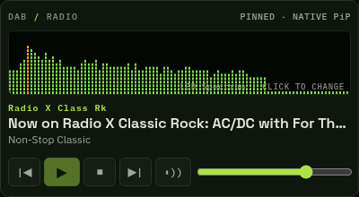
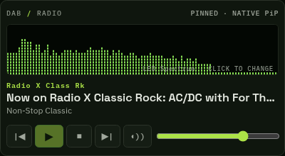
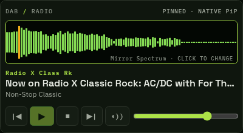
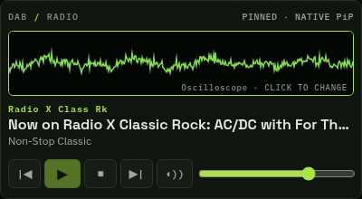
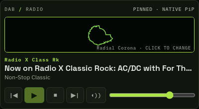
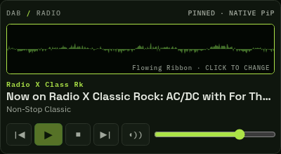
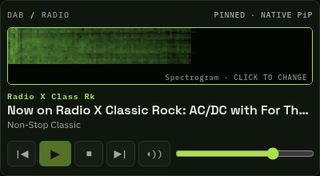

# DAB Radio

A real DAB/DAB+ network audio player for Raspberry Pi and Debian. Tune one multiplex at a time, browse discovered stations, and listen in a focused, Winamp-inspired browser deck with live broadcast radio text.

The service uses an RTL-SDR receiver and serves the browser player at `http://<host>:8090`. Debian packages target Debian 13 (Trixie) and 64-bit Raspberry Pi OS Trixie on `arm64` and `amd64`. Check [GitHub Releases](https://github.com/AieatAssam/dab-radio/releases/latest) for available packages. See [installation](docs/INSTALL.md) and [release process](docs/RELEASING.md).

## Screenshots

Captured from a running receiver in Chromium using live audio and broadcast metadata. Station availability, track text and artwork vary with reception and broadcaster output.

### Listening deck



<details>
<summary>Mobile layout</summary>



</details>

### Mini-player

The compact player shares the main tab's audio, EQ and volume. These captures show native Document Picture-in-Picture content; browser and operating-system window controls vary.



Click the visualisation to cycle through six modes:

| LED Spectrum | Mirror Spectrum |
| --- | --- |
|  |  |
| **Oscilloscope** | **Radial Corona** |
|  |  |
| **Flowing Ribbon** | **Spectrogram** |
|  |  |

Broadcaster-provided logos, artwork and broadcast content retain their respective rights and are not covered by this project's MIT license.

## Features

- Live DAB/DAB+ reception and browser audio from one RTL-SDR tuner.
- Station catalogue and selection across scanned multiplexes; one multiplex is received at a time.
- Prominent broadcast radio text, including DL+ typed metadata when transmitted, plus station logos, artwork and programme schedules where available through RadioDNS.
- Browser MP3 delivery with broadcast encoding/bitrate/channel mode identified separately from browser delivery encoding.
- Shared stream fan-out, playback headroom, EQ and limiting; visualisations analyse actual decoded audio.
- Technical receiver and stream statistics in a panel closed by default, including real buffering and receiver error counters.
- Adaptive Band III scanning. Scanning interrupts live reception; cancelling restores the prior station. Reception errors and missing broadcast audio cannot be repaired by software.
- Mini-player with six audio visualisation modes. Native pinned Document Picture-in-Picture requires a supporting browser and HTTPS or localhost; a popup fallback may be available.

SPI service data, station logos and schedules can be fetched from public RadioDNS services when internet access is available. Missing internet or guide data does not prevent listening. MOT slides from the broadcast take priority over hybrid artwork. See [mini-player details](#mini-player) and [rich metadata and scanning](#rich-metadata-and-scanning).

## Install

For a packaged installation, see [docs/INSTALL.md](docs/INSTALL.md). The package targets Debian 13 or 64-bit Raspberry Pi OS Trixie (`arm64` or `amd64`), installs the service under `/opt/dab-radio`, stores runtime state under `/var/lib/dab-radio`, and uses `/etc/dab-radio/dab-radio.conf`. It bundles the decoder and Python runtime dependencies, so installation does not compile source on the target or download Python packages with pip. `apt` may fetch operating-system libraries from configured Debian repositories.

### Development checkout

Package installation does not migrate or replace an existing source checkout; treat an existing checkout deployment separately when planning a migration.

For a source build, Python development dependencies are in `requirements.txt`; package runtime dependencies are pinned separately in `requirements-runtime.txt`. Build the patched decoder with `./scripts/build-decoder.sh`; its revision, patch attribution and native test are documented in [patches/README.md](patches/README.md). Native compilation needs build dependencies including `build-essential`, `cmake`, `pkg-config`, `libasound2-dev`, `libfaad-dev`, `libmpg123-dev`, `libfftw3-dev`, `librtlsdr-dev`, `libmp3lame-dev` and `xxd`.

The deployment scripts support the existing checkout workflow. They do not install or upgrade Python packages. Service commands for that deployment:

```bash
sudo systemctl status dab-radio.service
sudo journalctl -u dab-radio.service -f
sudo systemctl stop dab-radio.service
```

## Listening interface

The player is a Winamp-inspired listening deck with live radio text prominent beside the station and transport controls. It labels broadcast format separately from MP3 delivery. The spectrum belongs to the decoded audio view; signal and stream diagnostics sit in a details drawer that is closed by default.

## Receiver and RF limits

One tuner receives one DAB ensemble at a time. Scanning interrupts reception. Reception varies with antenna, location, interference and device conditions. RF reception is real time; software cannot guarantee zero dropped RF frames or restore audio frames missing from a broadcast or reception.

Browser playback applies at least 6 dB of headroom before the EQ and a compressor/limiter before output. EQ boosts increase attenuation automatically. These protections cannot repair distortion or lost audio frames.

## Tests and browser checks

Run backend tests from the project virtual environment:

```bash
.venv/bin/python -m pytest -q
```

The suite checks tune validation, nullable receiver state, broadcast-versus-delivery codec fields, MP3 route headers and chunk forwarding, shared stream fan-out, slow-subscriber overflow disconnection and unsubscribe cleanup. These tests mock the audio upstream and do not start the FastAPI lifespan, Uvicorn or SDR hardware. RF continuity is not asserted because real-time reception can lose frames.

## Rich metadata and scanning

DL+ is decoded natively from the selected programme's existing PAD data. Typed title, artist, album, presenter and programme fields are exposed only when transmitted; plain radio text is not guessed into artist/title fields. The audio decoder and MP3 encoder are unchanged.

SPI service information, station logos and published programme schedules are acquired through RadioDNS over the internet. These are labelled separately from broadcast MOT slides, which take priority. The existing receiver does not decode the dedicated packet-mode binary SPI broadcast carousel. Using the broadcaster's hybrid SPI service adds no extra RF subchannel decoding and never retunes the receiver. Missing internet or unpublished guide information does not stop listening.

Full Band III scanning is adaptive: approximately 3 seconds on empty channels; at least 8 seconds and 3 seconds of stable, complete labels on good signals; up to 15 seconds for incomplete signalling, or 30 seconds for weak acquired ensembles. SNR alone does not count as an acquired ensemble. These are conservative receiver-style acquisition limits, not a claim that all commercial radios use one timeout. Unsuccessful scans retain previously discovered stations and flag their channels stale. Cancel restores the previous station; an already-playing browser resumes after the scan finishes or is cancelled.

## Mini-player

Use the small window icon beside Refresh to open the mini-player. It shares the main tab's audio session, limiter, EQ and volume. Previous/Next follow the main playlist's current search, ensemble and favourites filters. Stop releases the live stream; Play starts fresh live audio. Closing the mini-player keeps listening in the main tab; closing the main tab closes the mini-player.

Click the visualisation (or focus it and press Enter/Space) to cycle through LED Spectrum, Mirror Spectrum, Oscilloscope, Radial Corona, Flowing Ribbon and Spectrogram. The chosen mode is remembered locally. Each mode uses the existing Web Audio analyser; no second audio stream or SDR decoder is started. Rendering uses the mini-window's animation clock so it can keep drawing while the opener is in the background. Reduced-motion preferences lower the frame rate; the spectrogram uses a small offscreen image buffer.

On a supporting desktop browser with HTTPS or a localhost address, the app opens a native Document Picture-in-Picture window that stays on top. On ordinary LAN HTTP, the mini-player button is disabled, with a tooltip explaining that HTTPS or localhost is required. Secure connections can use a standard popup fallback on browsers without Document PiP. See [MDN's Document PiP support and secure-context requirements](https://developer.mozilla.org/en-US/docs/Web/API/Document_Picture-in-Picture_API).

To use native pinned mode from another computer without changing the Pi's service or configuring TLS, an optional SSH tunnel makes the app available on localhost:

```bash
# Run on the computer with your browser; leave this terminal open.
ssh -N -L 18090:127.0.0.1:8090 <user>@<host>
```

Then visit `http://localhost:18090/` in a browser that supports Document PiP and open the mini-player. Browser popup permissions still apply to fallback windows.

## Credits

This player builds on the work of these projects and their contributors. The browser interface uses native Canvas and Web Audio APIs; it does not ship a JavaScript UI framework or a separate visualisation library.

### Runtime and receiver

| Project | Contribution | License |
| --- | --- | --- |
| [FastAPI](https://github.com/fastapi/fastapi) | Web API and streaming endpoints | MIT |
| [Uvicorn](https://github.com/Kludex/uvicorn) | ASGI server | BSD-3-Clause |
| [Starlette](https://github.com/Kludex/starlette) | ASGI responses, routing and static files | BSD-3-Clause |
| [HTTPX](https://github.com/encode/httpx) | Receiver proxy and SPI HTTP client | BSD-3-Clause |
| [Pydantic / pydantic-core](https://github.com/pydantic/pydantic) | Request validation | MIT |
| [defusedxml](https://github.com/tiran/defusedxml) | Safe SPI XML parsing | PSF License |
| [dnspython](https://github.com/rthalley/dnspython) | RadioDNS discovery | ISC |
| [welle.io](https://github.com/AlbrechtL/welle.io) | DAB/DAB+ reception, decoding and stream delivery | GPL-2.0-or-later upstream; see patched-decoder scope below |
| [DABlin](https://github.com/Opendigitalradio/dablin), Stefan Pöschel | PAD decoding and the DL+ implementation adapted by our decoder patch | GPL-3.0-or-later |
| [RTL-SDR](https://osmocom.org/projects/rtl-sdr/wiki) | Nooelec/RTL2832U hardware access | GPL; component-specific notices apply |
| [FFTW](https://www.fftw.org/), [FAAD2](https://github.com/knik0/faad2) | FFT processing and AAC decoding | GPL; see detailed notices |
| [mpg123](https://www.mpg123.de/), [LAME](https://lame.sourceforge.io/) | MPEG audio decoding and MP3 encoding | LGPL; see detailed notices |
| [libusb](https://libusb.info/), [ALSA](https://www.alsa-project.org/) | USB and system audio support | LGPL-2.1-or-later |

Additional server dependencies include AnyIO, uvloop, httptools, websockets, watchfiles, PyYAML, h11, httpcore, certifi and others. Their installed versions, license summaries and retained notices are listed in [THIRD_PARTY_NOTICES.md](THIRD_PARTY_NOTICES.md).

### Fonts and development tools

| Project | Contribution | License |
| --- | --- | --- |
| [IBM Plex Sans and IBM Plex Mono](https://github.com/IBM/plex) | Interface and technical readout typography | SIL Open Font License 1.1 |
| [Space Grotesk](https://github.com/floriankarsten/space-grotesk) | Display typography | SIL Open Font License 1.1 |
| [Hallmark](https://github.com/Nutlope/hallmark), by Together AI | Anti-AI-slop design guidance and UI quality checks; development tooling, not a runtime UI library | MIT |
| [Playwright](https://github.com/microsoft/playwright) and its [Codex skill](.agents/skills/playwright/NOTICE.txt) | Browser verification and screenshots | Apache-2.0 |
| [pytest](https://github.com/pytest-dev/pytest) | Backend and metadata tests | MIT |

The interface is inspired by classic Winamp listening decks; it does not bundle Winamp code, skins or logos. DAB, SPI and RadioDNS specifications and broadcaster services make the reception and metadata features possible.

## License

The original Python service, browser application, project scripts and original documentation are available under the **[MIT License](LICENSE)**, copyright © 2026 Aieat Assam.

Third-party software and assets retain their own licenses. In particular, the DABlin-derived decoder code and `patches/welle-dlplus.patch` remain **GPL-3.0-or-later**; the separately built patched decoder is not relicensed under MIT. Fonts remain under OFL, and development skills retain their upstream terms. Broadcast artwork and content are not included in the MIT grant.

See [THIRD_PARTY_NOTICES.md](THIRD_PARTY_NOTICES.md), the retained texts in [licenses/](licenses/), and [decoder patch attribution](patches/README.md) for detailed credits and licensing boundaries.
